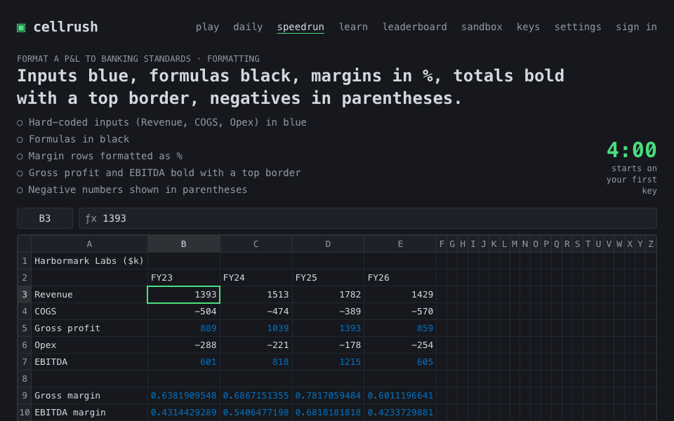
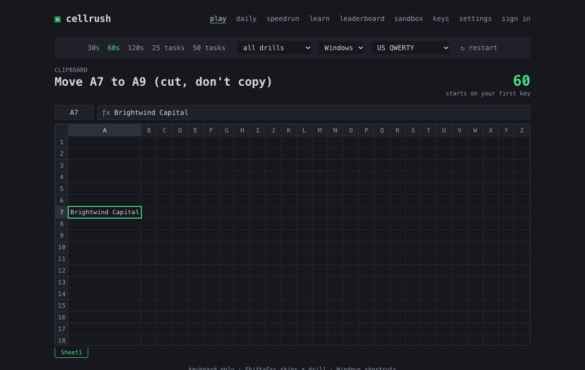
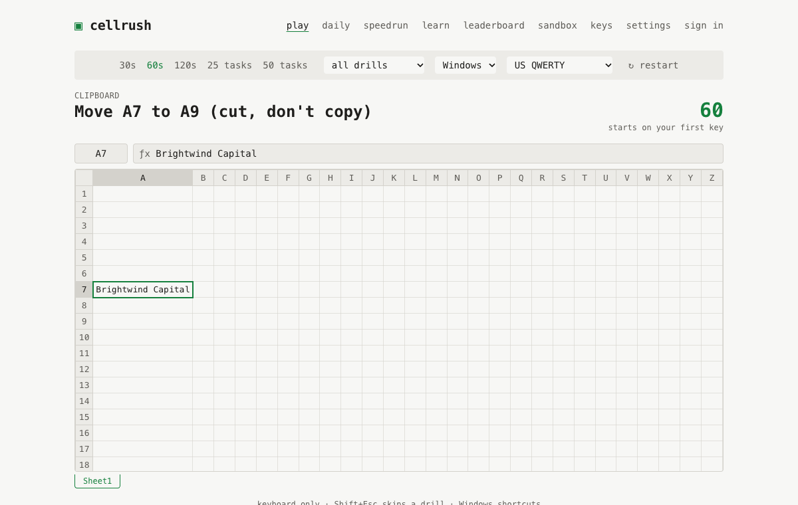
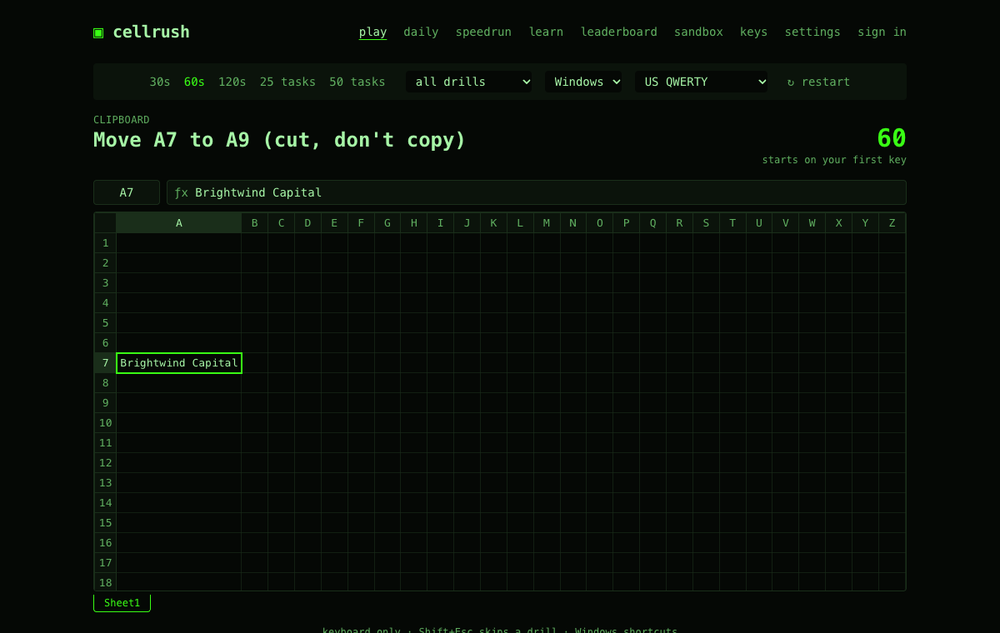

<div align="center">

#  cellrush

**Monkeytype for spreadsheets. How fast are you without a mouse?**

<!-- The site goes live with the launch; this link starts working then. -->
[**▶ Play now**](https://cellrush.app) · [Daily challenge](https://cellrush.app/daily) · [Analyst speedruns](https://cellrush.app/speedrun)

[](https://github.com/joaquimmj/cellrush/actions/workflows/ci.yml)
[](LICENSE)
[](packages/drills/src/tasks)
[](#performance)



</div>

A free, open-source speed trainer for Excel keyboard shortcuts. It runs in the browser, on a
spreadsheet engine written from scratch, and the **mouse is switched off**. Jump, select, fill,
anchor with F4, paste values, build a P&L, all against the clock.

## Features

- **Timed runs, Monkeytype-style.** 30 s · 60 s · 120 s · 25 or 50 drills. Score = drills per minute × keystroke efficiency.
- **74 drills + 3 Analyst-mode speedruns.** Navigation, selection, editing, formatting, rows & columns, clipboard, formulas (with a real formula engine), sheets, ribbon keytips.
- **Daily challenge** with a shareable result: `cellrush daily #42 ⏱ 48.3s 🟩🟩🟨🟩⬛…`
- **Leaderboards you can trust:** every run is replayed keystroke by keystroke on the server. By country and by school, too.
- **Windows and Mac shortcuts**, US / UK / AZERTY / QWERTZ layouts, English and French, 8 themes, and a Learn mode that brings back what you miss.

## Modes

| Mode | What |
|---|---|
| **Play** (`/`) | Timed run of random drills. Filter by category. |
| **Daily** (`/daily`) | Same 10 drills for everyone today. First attempt is ranked. |
| **Speedrun** (`/speedrun`) | *Format a P&L to banking standards*, *Build a revenue projection*, *Clean a data dump*. Checklist at the end. |
| **Learn** (`/learn`) | No timer. The keys appear after 4 s of hesitation. Missed shortcuts come back more often. |
| **Sandbox** (`/sandbox`) | A free grid to try things. |

## Themes

| Dark | Light | Terminal green |
|---|---|---|
|  |  |  |

Plus amber terminal, navy, paper, high contrast and navy & gold. [Add yours →](docs/ADDING_A_THEME.md)

## Keyboard support

| | Windows | macOS |
|---|---|---|
| Shortcut set | Excel for Windows | Excel for Mac (Cmd-based). No invented equivalents: drills with no Mac shortcut (ribbon keytips, font colour) are Windows-only. |
| Source | Shortcuts are checked against Microsoft's [Keyboard shortcuts in Excel](https://support.microsoft.com/en-us/office/keyboard-shortcuts-in-excel-1798d9d5-842a-42b8-9c99-9b7213f0040f), per platform, and each one records whether it was (`verified` in the [registry](packages/engine/src/keymap/registry.ts)). A few Windows ribbon keytips (Alt, H, O, I…) aren't on that page: they're marked unverified and stay in Learn mode and practice runs, never in ranked modes or the Daily ([ranked.ts](packages/drills/src/ranked.ts)). | same |
| Layouts | US, UK, French AZERTY, German QWERTZ: letter shortcuts follow the printed key, digit-row shortcuts the physical key ([details](docs/KEYBOARD.md)). | same |

**Browsers.** Chrome and Edge give the most keys to the page, and fullscreen + Keyboard Lock frees
the rest. Some combos (Ctrl/Cmd + W, T, N…) belong to the browser, so drills avoid them. You can
check your own browser at [`/keys`](https://cellrush.app/keys); its results feed
[the capture matrix](packages/engine/src/keymap/capture-matrix.json). Playing needs a physical
keyboard; on phones, the leaderboards still work.

## Performance

Measured on the production build: a keystroke goes from `keydown` to an updated grid in
**0.6 ms median, 7 ms p95** (budget: one 16 ms frame). Lighthouse: **98–99 performance,
100 accessibility, best practices and SEO**. Every page except the game loads on demand.

## How it works

```
packages/engine   spreadsheet engine from scratch: grid, selection, edit modes, undo/redo,
                  formula parser + evaluator, reference shifting, keymap (Win/Mac × 4 layouts)
packages/drills   74 drills + 3 scenarios as data, seeded RNG, run engine, scoring, replay validation
apps/web          React + Vite + Tailwind UI
supabase/         Postgres + RLS, auth, and the submit-run Edge Function that replays every run
```

The server never trusts a score: the browser sends only keystrokes, the Edge Function replays
them with **the same engine bundle** and computes the score itself. Runs that look scripted
(inhuman speed, robotic timing, impossible drills/min) are stored but not ranked.
More: [ARCHITECTURE](docs/ARCHITECTURE.md) · [SCORING](docs/SCORING.md) · [SERVER](docs/SERVER.md).

Tested: 443 engine tests, 768 drill tests (a bot plays every drill's optimal path on both
platforms and four layouts), 16 server integration tests (tampered scores, RLS, rate limits),
24 Playwright end-to-end tests (full 60 s runs on Windows and Mac keymaps).

## Self-hosting

1. `pnpm install` (Node 20+, pnpm 10).
2. Create a Supabase project, then `supabase link` and `supabase db push` (migrations in `supabase/migrations`).
3. `pnpm build:edge && supabase functions deploy submit-run`.
4. On Vercel, import the repo with root `apps/web`, and set `VITE_SUPABASE_URL` and `VITE_SUPABASE_ANON_KEY`.
5. Deploy. `vercel.json` already routes `/r/:id` share links and the `/api/og` preview image.

Local development with Docker: `pnpm db:start && pnpm env:local && pnpm dev`, see [docs/SERVER.md](docs/SERVER.md).

## Contributing

New drills and themes are the best first PRs: plain data, with a test that tells you when it's
right. Start with [CONTRIBUTING.md](CONTRIBUTING.md) and the
[`good first issue`](https://github.com/joaquimmj/cellrush/labels/good%20first%20issue) label.

## Star history

[](https://star-history.com/#joaquimmj/cellrush&Date)

## Credits

Made by Joaquim, founder of [Aptence](https://aptence.app) & [QuantAcademy](https://quantacademy.app).

[AGPL-3.0](LICENSE). You can self-host and modify cellrush; if you run a modified version as a
public service, you must publish your changes under the same license.

Not affiliated with Microsoft. Excel is a trademark of Microsoft Corporation.
